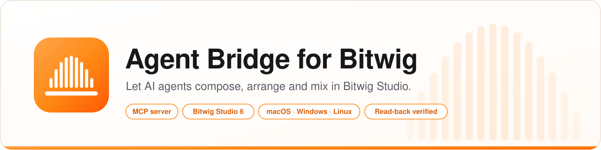
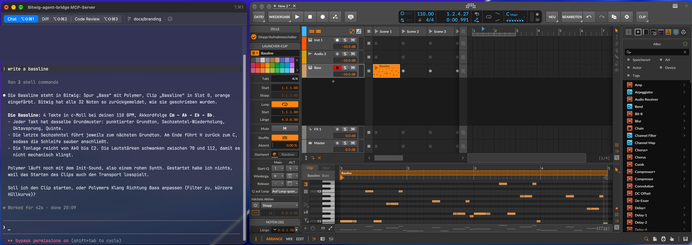

<p align="center">
  <picture>
    <source media="(prefers-color-scheme: dark)" srcset="assets/banner-dark.svg">
    
  </picture>
</p>

<p align="center">
  <a href="LICENSE"></a>
  
  
  
  
  
</p>

<p align="center">
  <a href="#quick-start">Quick start</a> ·
  <a href="#what-you-can-ask">Examples</a> ·
  <a href="#tools">Tools</a> ·
  <a href="#documentation">Docs</a>
</p>

Tell an agent what to change in Bitwig Studio. Bitwig Agent Bridge does it on your Mac, then checks that Bitwig actually did it.

Bitwig Agent Bridge is a local [MCP](https://modelcontextprotocol.io) server for Bitwig Studio 6 on macOS. It gives an agent such as Claude Code exact, read-back-verified control of tracks, the mixer, devices and plug-in parameters, launcher clips and notes, scenes, the transport and Bitwig's own actions, so it can compose, arrange and mix.

<p align="center">
  
</p>

## Why

- **Exact targets.** Tracks are addressed by Bitwig's track id, which survives renaming and moving. Devices, scenes and clips are addressed by index plus their exact current name, so a stale target is refused instead of changing the wrong thing.
- **Read back.** A change is reported as done only once Bitwig shows it. Otherwise the reply says what Bitwig holds now.
- **Strict inputs.** All 24 tools have strict JSON schemas; unknown fields are rejected.
- **Local only.** Everything runs on your Mac over loopback. Nothing is exposed to the network.

> Bitwig Studio is a product of Bitwig GmbH. This project is an independent community tool and is not affiliated with or endorsed by Bitwig.

## Quick start

You need macOS 13 or newer, Bitwig Studio 6 (tested with 6.1.7) and Node.js 20 or newer.

1. **Install.** In the checkout, run `npm run setup`. It installs the dependencies, creates a private secret and installs the controller script into Bitwig's controller folder.
2. **Add the controller in Bitwig, once.** **Settings → Controllers → + Add Controller**, vendor **Bitwig Agent Bridge**, controller of the same name. Bitwig shows "Bitwig Agent Bridge online".
3. **Register the server with Claude Code**, with the absolute path of your checkout:

   ```sh
   claude mcp add --scope user bitwig -- node /path/to/bitwig-agent-bridge/src/index.mjs
   ```

4. **Try it.** With Bitwig open, ask Claude Code: "Call bitwig_status and list the tracks."

Other agents (Claude Desktop, Codex, Cursor, VS Code and more) and every step in detail: [Setup](docs/setup.md).

## What you can ask

- "Make an instrument track called Keys, put Polymer on it and write a four-bar chord progression in A minor into slot 0."
- "Set the tempo to 124 BPM, turn the metronome on and start playback."
- "Duplicate scene 2, name the copy Chorus and color it orange."
- "Pull the bass down 3 dB, pan the hats 20 % right and send the snare to the reverb at −12 dB."
- "List the remote controls on the first device of the Lead track and open the filter a bit."
- "Delete the clip Sketch in slot 3 on the Drums track."

The agent picks the tools. Every change comes back with what Bitwig reports, so a refused or ignored change shows up in the reply.

## Tools

24 tools, each with a strict input schema. Details for every tool: [Tool reference](docs/tools.md).

| Area | Tool | What it does |
|---|---|---|
| Status & session | [`bitwig_status`](docs/tools.md#bitwig_status) | Bridge, Bitwig, project, selection and audio engine at a glance |
|  | [`bitwig_actions`](docs/tools.md#bitwig_actions) | Search Bitwig's ~780 menu and shortcut actions |
|  | [`bitwig_invoke_action`](docs/tools.md#bitwig_invoke_action) | Run one action, undo or redo, or switch the panel layout |
|  | [`bitwig_transport`](docs/tools.md#bitwig_transport) | Read or change play, record, tempo, meter, position, loop, metronome and more |
|  | [`bitwig_track_meters`](docs/tools.md#bitwig_track_meters) | Peak levels per track, for playback checks |
| Tracks | [`bitwig_tracks`](docs/tools.md#bitwig_tracks) | List main, effect and master tracks with mixer state and sends |
|  | [`bitwig_create_track`](docs/tools.md#bitwig_create_track) | Create an instrument, audio or effect track |
|  | [`bitwig_set_track`](docs/tools.md#bitwig_set_track) | Name, color, volume, pan, mute, solo, arm and sends |
|  | [`bitwig_delete`](docs/tools.md#bitwig_delete) | Delete a track, device, scene or launcher clip |
| Clips & arrangement | [`bitwig_read_clip`](docs/tools.md#bitwig_read_clip) | Read a launcher clip with all its notes |
|  | [`bitwig_write_clip`](docs/tools.md#bitwig_write_clip) | Write a complete MIDI clip, verified note by note |
|  | [`bitwig_edit_clip`](docs/tools.md#bitwig_edit_clip) | Add, change or remove single notes; rename, recolor, set the loop |
|  | [`bitwig_arrange_launcher_clips`](docs/tools.md#bitwig_arrange_launcher_clips) | Print launcher clips into the Arranger at exact beats |
|  | [`bitwig_cue_markers`](docs/tools.md#bitwig_cue_markers) | List and place Arranger cue markers |
| Scenes & launcher | [`bitwig_launcher`](docs/tools.md#bitwig_launcher) | Read scenes, clips and their play state |
|  | [`bitwig_edit_scene`](docs/tools.md#bitwig_edit_scene) | Create, duplicate, name and color scenes |
|  | [`bitwig_launch`](docs/tools.md#bitwig_launch) | Launch or stop scenes and clips, return to the arrangement |
| Devices & parameters | [`bitwig_devices`](docs/tools.md#bitwig_devices) | List the devices on a track |
|  | [`bitwig_browser_search`](docs/tools.md#bitwig_browser_search) | Search devices, presets and plug-ins in Bitwig's browser |
|  | [`bitwig_insert_device`](docs/tools.md#bitwig_insert_device) | Insert a device, preset or plug-in by exact name |
|  | [`bitwig_insert_sample`](docs/tools.md#bitwig_insert_sample) | Load a sample file into a new Sampler |
|  | [`bitwig_set_device`](docs/tools.md#bitwig_set_device) | Turn on or off, open the plug-in window, expand, pick the remote-controls page |
|  | [`bitwig_device_parameters`](docs/tools.md#bitwig_device_parameters) | Read remote controls and all direct parameters |
|  | [`bitwig_set_device_parameters`](docs/tools.md#bitwig_set_device_parameters) | Set up to 32 parameters at once, read back |

## Documentation

- [Setup](docs/setup.md): install, Bitwig, all supported agents, uninstall
- [Tool reference](docs/tools.md): every tool, its fields and how it verifies
- [Limitations](docs/limitations.md): what the Controller API cannot do, and Bitwig behavior measured in 6.1.7
- [Troubleshooting](docs/troubleshooting.md): timeouts, secrets, browser and track issues
- [Development](docs/development.md): how it works, security model, tests
- [Changelog](CHANGELOG.md)

## Support

Bitwig Agent Bridge is a hobby project, maintained on a best-effort basis. Found a bug or missing something? [Open an issue](https://github.com/zkyron-de/bitwig-agent-bridge/issues/new/choose) with the form; it asks for the Bitwig version and display language, which matter for many reports.

## Origin and license

Bitwig Agent Bridge is based on [Bitwig Control Deck](https://github.com/remymazmanian/bitwig-control-deck) by Remy Mazmanian, released under the MIT License. The original copyright notice is kept in [LICENSE](LICENSE).
